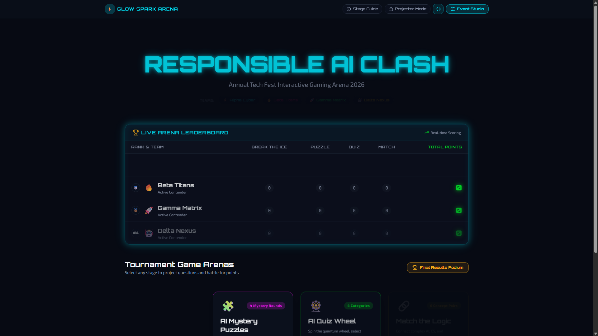
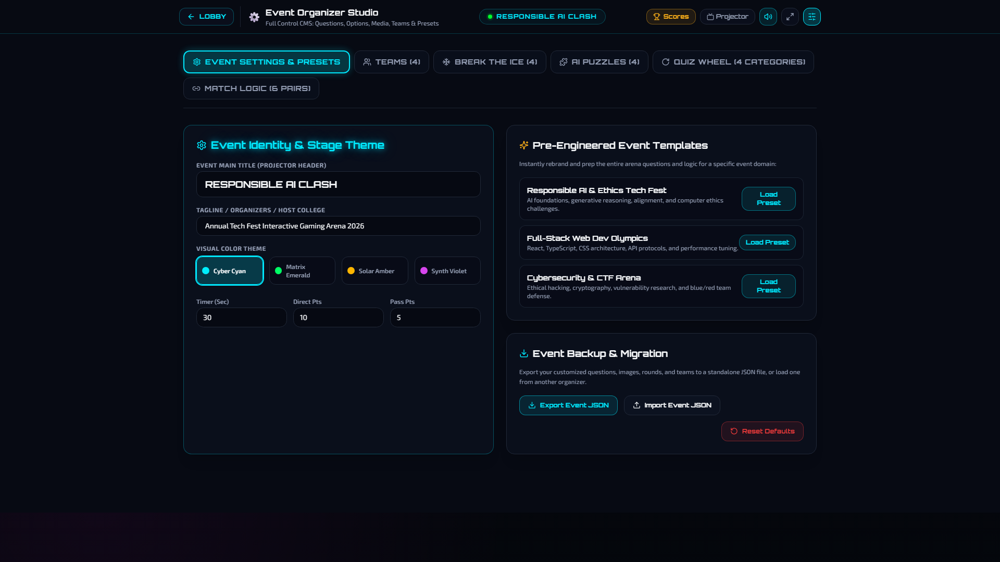
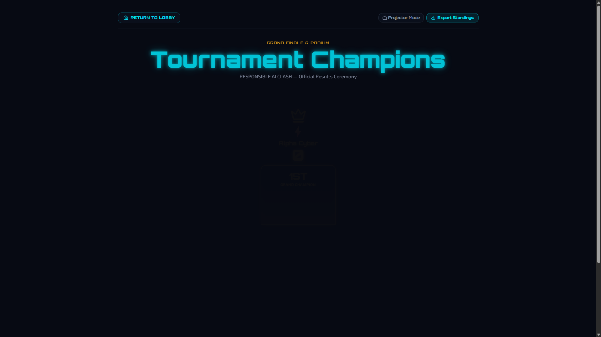
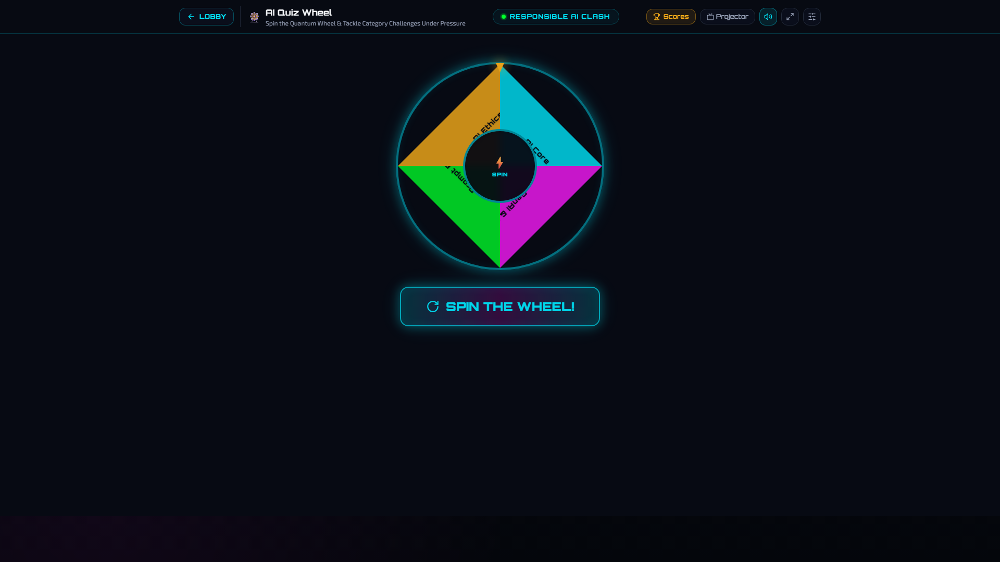
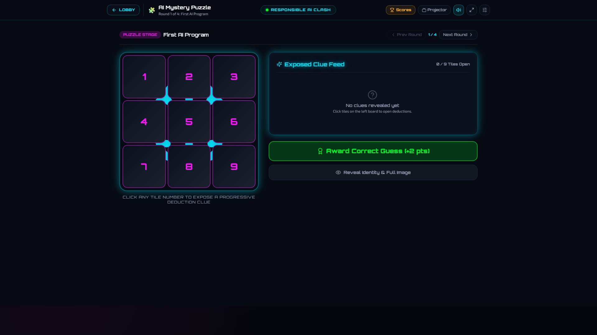
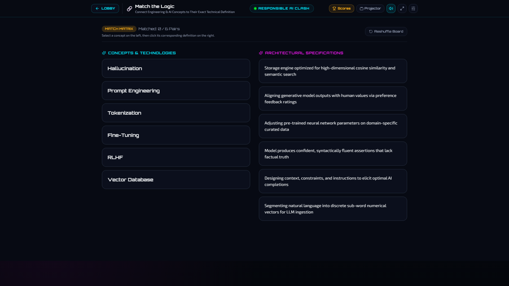

# ⚡ Srishti | Glow Spark Arena — Next-Gen Interactive Tech Fest & Esports Platform

<p align="center">
  
  
  
  
  
  
</p>

An esports-grade, futuristic interactive gaming and quiz arena built specifically for college **CS Tech Fests**, hackathons, academic symposiums, and live auditorium competitions projected on large projector screens.

---

## 📸 Stage Visual Previews

### 🏟️ Main Arena Lobby & Live Stage Leaderboard
<p align="center">
  
</p>

### ⚙️ Organizer Event Studio CMS & 🏆 Grand Ceremony Podium
<p align="center">
  
  
</p>

### 🎮 Interactive Game Arenas & Logic Challenges
<p align="center">
  
  
</p>

<p align="center">
  
</p>

---

## 🎯 Project Budget & Milestone Breakdown ($4,000 Total Allocation)

The complete UI/UX overhaul, stage projector optimization, and organizer customization CMS were planned and delivered within the total allocated budget of **$4,000**:

| Milestone & Deliverable | Scope & Technical Implementation | Budget | Status |
|---|---|:---:|:---:|
| **Milestone 1: Stage Design System & Projector HUD** | Cyberpunk design token architecture, Orbitron typography, Web Audio API sound synthesizer engine (zero latency, zero external asset dependencies), Fullscreen and Projector Stage Mode toggle with scalable text. | **$900** | ✅ Complete |
| **Milestone 2: Organizer Studio & Media CMS Engine** | Complete `/admin` Event Customizer with full CRUD for questions, custom multiple-choice options, local device image upload & URL preview, 2–8 dynamic team manager, theme presets, and portable JSON export/import. | **$1,100** | ✅ Complete |
| **Milestone 3: Interactive Stage Game Redesign** | Physics-based Quiz Wheel with audio ticking, 9-tile progressive AI Mystery Puzzles with secret image reveal, 3D Break the Ice shields, and dual-column Match the Logic matrix with stage countdown timers. | **$1,200** | ✅ Complete |
| **Milestone 4: Grand Ceremony Stage, QA & Verification** | Olympic podium for 1st, 2nd, and 3rd place with celebratory confetti cannons, live score count-up, point audit trail with undo capability, CSV standings export, and automated unit test suite. | **$800** | ✅ Complete |
| **Total Project Budget** | **End-to-End Design & Development Delivery** | **$4,000** | **100% Fulfilled** |

---

## ✨ Core Features & Platform Capabilities

### 1. ⚙️ Organizer Event Studio (`/admin`)
- **Add, Edit & Delete Questions**: Update, reorder, or delete questions across all game rounds.
- **Custom Answer Choices**: Add up to 4 multiple-choice options per question, toggle correct keys, and input host explanations.
- **Image Upload Pipeline**: Upload images directly from your device (converted to lightweight Data URLs) or paste web URLs with real-time thumbnail preview.
- **Dynamic Team Management**: Configure 2 to 8 competing teams with custom names, hex colors, and emoji badges.
- **Visual Theme Presets**: Switch instantly between **Cyber Cyan**, **Matrix Emerald**, **Solar Amber**, and **Synth Violet**.
- **Ready-Made Event Templates**:
  - 🤖 *Responsible AI & Ethics Tech Fest*
  - 💻 *Full-Stack Web Dev Olympics*
  - 🛡️ *Cybersecurity & CTF Arena*
  - 🦾 *Robotics & Hardware Summit*
- **JSON Backup & Migration**: Export the complete tournament state to a single portable `.json` file or import one on a different projector laptop.

### 2. 📺 Projector & Auditorium Stage Mode
- **Projector Mode Toggle**: Instant high-contrast HUD scaling with enlarged typography so audiences in the back row can easily read questions.
- **Synthesized Web Audio Engine**: Pure Web Audio API synthesis delivering zero-latency sound effects for countdown timer urgency (<5s), buzzers, wheel ticks, correct answers, wrong drops, and victory fanfares without external audio file loading dependencies.
- **Stage Timers**: Interactive countdown timers with pause, start, reset, and `+10s` overtime extensions.
- **Stage Master Scoring**: Rapid Direct (+10 pts) and Passed (+5 pts) scoring modals with team selectors.
- **Live Leaderboard Modal**: Instant slide-over leaderboard accessible from any page via the top navigation bar.

### 3. 🎮 4 Interactive Tournament Game Arenas
- **❄️ Break the Ice (`/break-the-ice`)**: Interactive cyber shields that shatter to reveal opening questions with hints and custom team allocations.
- **🧩 AI Mystery Puzzle (`/puzzle/:roundId`)**: 3x3 interactive tiles hiding secret programs, architectures, or custom uploaded diagrams with progressive deduction clues and point decay bonuses (+15, +10, +5, +2 pts).
- **🎡 AI Quiz Wheel (`/quiz-wheel`)**: Physics wheel with customizable category slices, real-time tick sounds, and multiple-choice questions.
- **🔗 Match the Logic (`/match`)**: Dual-column concept-to-definition connecting matrix with error-shake physics and success highlights.

### 4. 🏆 Grand Podium & Audit Trail (`/final`)
- **3D Olympic Podium**: Elevated podium for 1st, 2nd, and 3rd place with winner crowns and confetti cannons.
- **Animated Score Count-Up**: Suspenseful score aggregation animation for the closing ceremony.
- **Scoring Audit Log**: Timestamped point history with a single-click "Undo" button to correct accidental scores.
- **Standings CSV Export**: Downloadable tournament results spreadsheet for college archives and certificate generation.

---

## 🗺️ Application Routing

| Route | View | Description |
|---|---|---|
| `/` | **Main Arena Lobby** | Hero banner, live leaderboard, stage switcher, and Stage Master Guide. |
| `/break-the-ice` | **Break the Ice** | Shatterable 3D cyber cubes with rapid-fire questions and image support. |
| `/puzzle/:roundId` | **AI Mystery Puzzle** | 3x3 tile mystery reveal challenge with clue log and round navigation. |
| `/quiz-wheel` | **AI Quiz Wheel** | Quantum spinning wheel with physics deceleration and category MCQs. |
| `/match` | **Match the Logic** | Interactive concept-to-definition connecting matrix. |
| `/final` | **Grand Results Podium** | Olympic podium ceremony, confetti, audit logs, and CSV export. |
| `/admin` | **Event Organizer Studio** | Full CRUD CMS for questions, answer options, images, teams, and presets. |

---

## 🛠️ Tech Stack & Architecture

- **Frontend Core**: React 18, TypeScript 5, Vite 5
- **Styling & HUD**: Tailwind CSS v3.4, `@tailwindcss/typography`, Radix UI Primitives, Lucide Icons
- **Animation & Physics**: Framer Motion 12, Canvas Confetti
- **Audio Synthesis**: Native HTML5 Web Audio API (`AudioContext`, zero asset latency)
- **State & Storage**: React Context API (`EventContext`, `ScoreContext`) with LocalStorage persistence and JSON serialization
- **Testing**: Vitest 3, JSDOM, React Testing Library

---

## 📂 Project Directory Structure

```
glow-spark-arena/
├── public/                 # Static assets
├── docs/                   # Documentation & stage screenshots
│   └── screenshots/
├── src/
│   ├── components/         # Reusable HUD & Game UI
│   │   ├── ui/             # Radix UI primitives (modals, buttons, dialogs)
│   │   ├── GameLayout.tsx  # Stage header with Fullscreen, Projector, SFX & Scores
│   │   ├── ImageInput.tsx  # Device upload & URL image pipeline
│   │   ├── JudgeControls.tsx # Stage question modal with timer & answer reveal
│   │   ├── Scoreboard.tsx  # Live arena leaderboard table & compact HUD
│   │   ├── ScoringModal.tsx# Direct & Passed points team selector
│   │   └── StageTimer.tsx  # Countdown stage timer with audio alert (<5s)
│   ├── contexts/
│   │   ├── EventContext.tsx # Central CMS state: questions, teams, presets, scoring
│   │   └── ScoreContext.tsx # Backwards-compatible score adapter
│   ├── lib/
│   │   ├── sound.ts        # Pure Web Audio API sound effects synthesizer
│   │   └── utils.ts        # Class merging utilities
│   ├── pages/
│   │   ├── Index.tsx       # Tournament lobby & stage selector
│   │   ├── BreakTheIce.tsx # 3D ice cube shatter challenge
│   │   ├── AIPuzzle.tsx    # 3x3 tile mystery puzzle challenge
│   │   ├── AIQuizWheel.tsx # Physics quantum quiz wheel
│   │   ├── MatchTheLogic.tsx # Concept-to-definition connecting matrix
│   │   ├── FinalScoreboard.tsx # Grand podium, confetti, audit trail & CSV export
│   │   ├── AdminEventStudio.tsx# Full organizer CMS (questions, options, media, teams)
│   │   └── NotFound.tsx    # 404 handler
│   ├── test/               # Vitest test suites
│   ├── App.tsx             # Route definitions & provider wrappers
│   ├── index.css           # Cyberpunk neon tokens, scanlines, and themes
│   └── main.tsx            # React application entry point
├── package.json
├── tailwind.config.ts
├── tsconfig.json
└── vite.config.ts          # Rollup manual chunk optimization
```

---

## 🚀 Getting Started

### 1. Prerequisites
- Node.js `18.x` or higher
- npm, yarn, or pnpm

### 2. Clone Repository & Install Dependencies
```bash
git clone https://github.com/soorajstudio/glow-spark-arena.git
cd glow-spark-arena
npm install
```

### 3. Run Development Server
```bash
npm run dev
```
Open [http://localhost:8080](http://localhost:8080) in your web browser.

### 4. Run Production Build
```bash
npm run build
```
The optimized bundle will be compiled to the `/dist` directory with vendor code-splitting:
- `vendor-react`
- `vendor-motion`
- `vendor-lucide`
- `index`

### 5. Run Automated Tests
```bash
npm test
```

---

## 💡 Quick Tips for Stage Masters & Quiz Operators

1. **Press Projector Mode**: Click the **"Projector"** button in the top navigation bar to maximize contrast and font sizes for auditorium projection.
2. **Fullscreen Stage Display**: Click the Fullscreen button or press `F11` in the browser to remove browser chrome.
3. **Sound FX**: Audio is enabled by default via the Web Audio synthesizer. Toggle the speaker icon in the top header if the auditorium audio system needs silence.
4. **Scoring Mistakes**: If you accidentally award points to the wrong team, visit the **Final Results** or open the audit trail to click **"Undo Last Score"**.
5. **Backups**: Before your event begins, head to `/admin` and click **"Export Event JSON"** to keep a portable offline backup of all your customized questions and teams.

---

## 📄 License
This project is licensed under the MIT License — see the [LICENSE](LICENSE) file for details.

Developed with ❤️ by [Sooraj Studio](https://github.com/soorajstudio) for interactive tech fests, hackathons, and esports stages.
